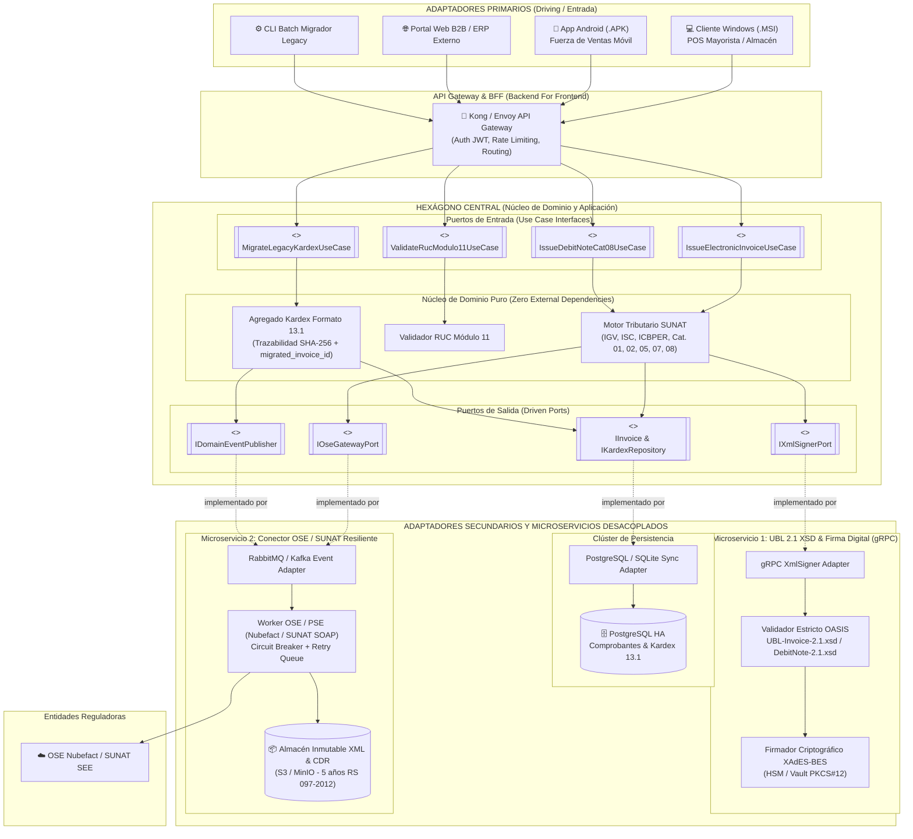

# Diagramas de Arquitectura: Monolito Limpio MVC hacia Arquitectura Hexagonal y Microservicios

- **Cliente:** ABC Software Corp (Comercializadora Mayorista y Minorista de Abarrotes)
- **Estándares Tributarios:** RS N° 097-2012/SUNAT (`UBL-Invoice-2.1.xsd`, Catálogos 01, 02, 05, 07, 08) y RS N° 234-2006/SUNAT (Kardex Formato 13.1).
- **Estrategia Evolutiva:** *Clean MVC Hexagonal-Ready* (Fase 1) $\rightarrow$ *Ports & Adapters / Microservicios* (Fase 2).

---

## 1. Diagrama 1: Estado Inicial — Monolito Limpio MVC con Puertos Desacoplados (Hexagonal-Ready)

En el **Estado Inicial**, la aplicación se despliega como un **Monolito Limpio MVC** empaquetado nativamente para **Windows (`.MSI`)** y **Android (`.APK`)**.
La clave arquitectónica es el **Principio de Inversión de Dependencias (DIP)**:
- La capa `views/` (Vista) invoca a `controllers/` (Controlador).
- Los `controllers/` orquestan la lógica apoyándose en `models/entities/` y `models/dtos/`.
- **Regla de Oro:** Ni `controllers/` ni `models/` importan clases concretas de `infrastructure/`. Toda salida hacia Base de Datos, Generador/Firmador XML UBL 2.1, Conector OSE/Nubefact o Importador Legacy ocurre exclusivamente a través de **Puertos (`models/ports/i_*_port.py`)**.

```mermaid
graph TD
    subgraph Client_Packages["Distribución Nativa Multiplataforma"]
        WIN_MSI["💻 Windows Desktop (.MSI)<br/>Cajas POS Mayorista / Almacén Central"]
        AND_APK["📱 Android Mobile (.APK)<br/>Preventa en Ruta / Auditoría Kardex"]
    end

    subgraph Clean_MVC_Monolith["Monolito Limpio MVC (Hexagonal-Ready)"]
        
        subgraph View_Layer["CAPA VISTA (src/views/multiplatform_ui/)"]
            UI_SHELL["AppShell (Flet / BeeWare Runtime)"]
            V_POS["PosBillingView<br/>(Emisión Factura/Boleta/Nota Débito Cat.08)"]
            V_KARDEX["KardexAuditView<br/>(Migración Fichas Legacy RS 234-2006)"]
        end

        subgraph Controller_Layer["CAPA CONTROLADOR (src/controllers/)"]
            C_BILL["BillingController<br/>(Orquestador Emisión UBL 2.1)"]
            C_MIG["KardexMigrationController<br/>(Orquestador Ingesta y Trazabilidad)"]
            C_TAX["TaxValidationController<br/>(Validador RUC Mód. 11 y Catálogos)"]
        end

        subgraph Model_Layer["CAPA MODELO / DOMINIO PURO (src/models/)"]
            subgraph Entities_DTOs["Entidades y Contratos (entities/ & dtos/)"]
                E_INV["Invoice & TaxCatalog<br/>(IGV 18%, ISC, ICBPER, Cat. 01/05/07/08)"]
                E_KAR["KardexEntry & Product<br/>(Formato 13.1 SUNAT)"]
                DTO_ALL["InvoiceRequestDTO / LegacyInventoryRecordDTO<br/>(Validación Pydantic + SHA-256)"]
            end

            subgraph Output_Ports["PUERTOS DE SALIDA - Interfaces ABC (src/models/ports/)"]
                P_INV_REPO[["<<interface>><br/>IInvoiceRepository"]]
                P_KAR_REPO[["<<interface>><br/>IKardexRepository"]]
                P_XML_SIGN[["<<interface>><br/>IXmlSignerPort<br/>(UBL 2.1 + XAdES-BES)"]]
                P_OSE_GW[["<<interface>><br/>IOseGatewayPort<br/>(Envío/Consulta CDR)"]]
            end
        end

        subgraph Infra_Layer["CAPA INFRAESTRUCTURA / ADAPTADORES SECUNDARIOS (src/infrastructure/)"]
            A_SQLITE["SqliteRepository<br/>(Persistencia Transaccional Local)"]
            A_CSV["LegacyCsvImporter<br/>(Lector Fichas Informales)"]
            A_UBL["Ubl21XmlBuilder + XadesBesSigner<br/>(lxml + XSD Validator + XMLDSig)"]
            A_OSE["OseRestSoapAdapter<br/>(Conector Nubefact / SUNAT SEE)"]
        end
    end

    subgraph External_Systems["Sistemas Externos y Normativos"]
        LEGACY_DB[("📄 Fichas Almacén Legacy<br/>(fecha, ingreso, salida, producto, nro_doc)")]
        OSE_SUNAT["☁️ OSE / SUNAT SEE<br/>(Nubefact API / WebService CDR)"]
        CERT_X509["🔐 Certificado Digital X.509<br/>(.PFX / .P12 Emisor)"]
    end

    %% Relaciones Vista -> Controlador
    WIN_MSI --> UI_SHELL
    AND_APK --> UI_SHELL
    UI_SHELL --> V_POS
    UI_SHELL --> V_KARDEX
    V_POS --> C_BILL
    V_POS --> C_TAX
    V_KARDEX --> C_MIG

    %% Relaciones Controlador -> Modelo y Puertos
    C_BILL --> E_INV
    C_BILL --> DTO_ALL
    C_BILL --> P_INV_REPO
    C_BILL --> P_XML_SIGN
    C_BILL --> P_OSE_GW

    C_MIG --> E_KAR
    C_MIG --> DTO_ALL
    C_MIG --> P_KAR_REPO
    C_MIG --> P_INV_REPO

    C_TAX --> E_INV

    %% Inversión de Dependencias: Infraestructura implementa Puertos del Modelo
    A_SQLITE -. "implementa" .-> P_INV_REPO
    A_SQLITE -. "implementa" .-> P_KAR_REPO
    A_CSV --> C_MIG
    A_UBL -. "implementa" .-> P_XML_SIGN
    A_OSE -. "implementa" .-> P_OSE_GW

    %% Salidas a Sistemas Externos
    A_CSV --> LEGACY_DB
    A_UBL --> CERT_X509
    A_OSE --> OSE_SUNAT
```

---

## 2. Diagrama 2: Estado Futuro — Evolución a Arquitectura Hexagonal y Microservicios

Gracias a que el **Modelo (`src/models/`)** no tiene dependencias hacia frameworks de UI ni librerías de infraestructura, en el **Estado Futuro** cuando ABC Software Corp escale a múltiples sucursales y alto volumen mayorista:
1. El paquete `models/` + casos de uso de `controllers/` se consolidan directamente como el **Hexágono de Dominio y Aplicación**.
2. Las Vistas (`.MSI` / `.APK`), un nuevo API Gateway REST/gRPC y los consumidores de colas pasan a ser **Adaptadores Primarios (Driving Adapters)**.
3. Los adaptadores pesados o críticos en regulación (**Motor Generador/Validador XSD UBL 2.1 + Firma XAdES-BES**, **Conector OSE/SUNAT con reintentos asíncronos**, y **Servicio de Inventario Kardex RS 234-2006**) se desprenden como **Microservicios Independientes** sin modificar una sola línea de las reglas tributarias del Dominio.

---

## 3. Comparativa de Transición Arquitectónica (Fase 1 vs. Fase 2)

| Dimensión | Fase 1: Monolito Limpio MVC (Actual) | Fase 2: Hexagonal + Microservicios (Futuro) | Impacto en `src/models/` (Dominio) |
|:---|:---|:---|:---|
| **Comunicación UI $\rightarrow$ Lógica** | Llamada en memoria `View` $\rightarrow$ `Controller` | Llamada HTTP/REST o gRPC vía API Gateway $\rightarrow$ `Inbound Port` | **0% cambios** en entidades y DTOs |
| **Generación y Firma UBL 2.1** | Adaptador local `Ubl21XmlBuilder` + `XadesBesSigner` | Microservicio gRPC dedicado con validación `UBL-Invoice-2.1.xsd` y HSM | **0% cambios** (se inyecta `GrpcXmlSignerAdapter` en `IXmlSignerPort`) |
| **Envío a OSE / SUNAT** | Adaptador HTTP/SOAP `OseRestSoapAdapter` | Microservicio Worker asíncrono con colas, Circuit Breaker y archivo S3 de CDRs | **0% cambios** (se inyecta `AsyncOseGatewayAdapter` en `IOseGatewayPort`) |
| **Persistencia Kardex (RS 234-2006)** | `SqliteRepository` embebido (offline-first en `.MSI`/`.APK`) | `PostgresRepository` centralizado + sincronización de bordes | **0% cambios** (ambos implementan `IKardexRepository`) |
