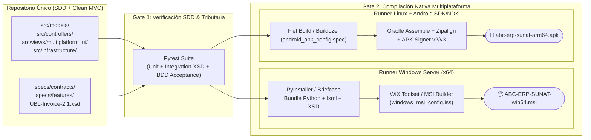

# ADR-0002: Estrategia y Pipeline de Empaquetado Nativo Multiplataforma para Windows (.MSI) y Android (.APK)

- **Estado:** Aceptado
- **Fecha:** 2026-10-22
- **Decisores:** Equipo de Arquitectura Senior & ABC Software Corp
- **Requisitos Vinculados:** Restricción #4 (Distribución Multiplataforma `.MSI` y `.APK`), FEAT-001

---

## 1. Contexto y Problemática

La operación comercial de **ABC Software Corp** combina dos entornos físicos muy distintos:
1. **Terminales de Escritorio Windows en Cajas POS y Almacén Central:** Requieren un instalador corporativo **`.MSI` (Windows Installer)** auditable por TI, que funcione *offline-first* con SQLite local, acceso a impresoras térmicas de tickets y lectura de fichas legacy CSV/Excel.
2. **Dispositivos Móviles / Tablets Android para Preventa Mayorista y Toma de Inventario en Almacén:** Requieren un paquete instalable **`.APK` (Android Package)** que ejecute exactamente las mismas validaciones tributarias SUNAT (RUC Módulo 11, cálculo IGV/ISC/ICBPER, Catálogo 08) y emita comprobantes hacia el OSE o sincronice con el almacén.

Mantener dos bases de código separadas (ej. C#/.NET para Windows y Kotlin/Java para Android) duplicaría el esfuerzo de mantenimiento y aumentaría el riesgo de discrepancias en el redondeo tributario SUNAT (`UBL-Invoice-2.1.xsd`).

---

## 2. Decisión Arquitectónica

Adoptamos una arquitectura de **Código Único (Single Codebase) en Python 3.11+** con separación estricta de la capa `src/views/multiplatform_ui/` y un pipeline de compilación nativo hacia **`.MSI` (Windows)** y **`.APK` (Android)**:

1. **Capa de Presentación Agnóstica (`src/views/multiplatform_ui/`):**
   - Implementada sobre **Flet (Flutter for Python) / BeeWare Briefcase**, donde los componentes visuales (`PosBillingView`, `KardexAuditView`) solo construyen DTOs (`InvoiceRequestDTO`, `LegacyInventoryRecordDTO`) y delegan toda la lógica a `src/controllers/`.

2. **Pipeline de Empaquetado Nativo Windows (`.MSI`):**
   - **Herramientas:** `PyInstaller` / `cx_Freeze` + **WiX Toolset v4** (o `Briefcase MSI Packaging`) configurado en `src/infrastructure/packaging/windows_msi_config.iss`.
   - **Artefacto resultante:** `ABC-ERP-SUNAT-v1.0.0-win64.msi`.
   - **Características incluidas:**
     - Runtime Python embebido sin requerir instalación previa en las PCs de caja.
     - Librerías nativas compiladas (`pydantic-core`, `lxml` con esquemas `UBL-Invoice-2.1.xsd` embebidos, `cryptography` / `signxml`).
     - Registro en *Add/Remove Programs*, accesos directos de escritorio y directorio de datos `%LOCALAPPDATA%\ABCSoftwareCorp\`.

3. **Pipeline de Empaquetado Nativo Android (`.APK`):**
   - **Herramientas:** `Flet Build APK` / `Buildozer (Python-for-Android)` configurado en `src/infrastructure/packaging/android_apk_config.spec`.
   - **Artefacto resultante:** `abc-erp-sunat-v1.0.0-release-signed.apk` (arquitecturas `arm64-v8a` y `armeabi-v7a`).
   - **Características incluidas:**
     - Permisos Android mínimos necesarios: `INTERNET`, `ACCESS_NETWORK_STATE`, `READ_EXTERNAL_STORAGE` / `WRITE_EXTERNAL_STORAGE` (para lectura de fichas legacy y descarga de PDF/XML/CDR).
     - Empaquetado íntegro de `src/models/`, `src/controllers/` y adaptadores REST/SQLite compatibles con el sandbox de Android.

---

## 3. Diagrama del Pipeline CI/CD de Empaquetado Multiplataforma (`.MSI` & `.APK`)

---

## 4. Consecuencias

### Positivas
- **Paridad Tributaria Absoluta (100%):** Tanto el cajero en Windows (`.MSI`) como el vendedor mayorista en Android (`.APK`) ejecutan exactamente el mismo motor `InvoiceRequestDTO` y `validate_peruvian_ruc_modulo11`, eliminando diferencias de céntimos en IGV, ISC o ICBPER.
- **Operación Offline/Online Híbrida:** Ambos paquetes cuentan con persistencia local (`SqliteRepository`) para encolar comprobantes o migrar fichas de almacén si cae el enlace a internet, sincronizando con el OSE apenas se restablezca la conectividad.

### Negativas / Mitigación en Android
- **Dependencias C en Android (`arm64-v8a`):** En caso de que una librería C de firma XML local presente restricciones en ciertos dispositivos Android antiguos, gracias al puerto `IXmlSignerPort` (definido en **ADR-0001**), el paquete `.APK` puede alternar limpiamente entre firma local en el dispositivo o delegación al adaptador OSE/Microservicio remoto sin cambiar la vista ni el controlador.
